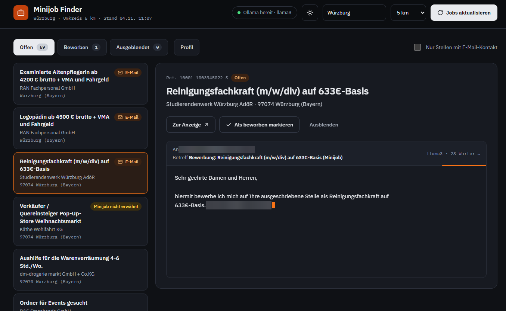
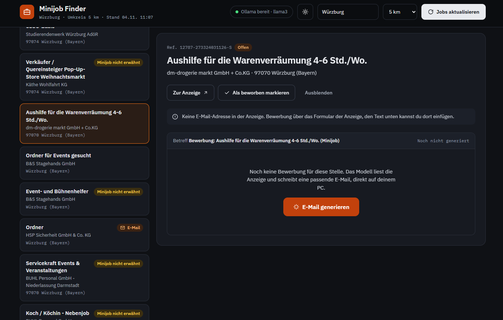
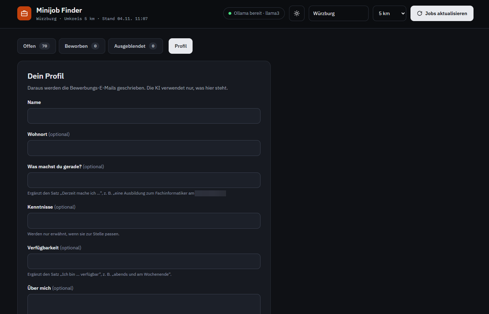
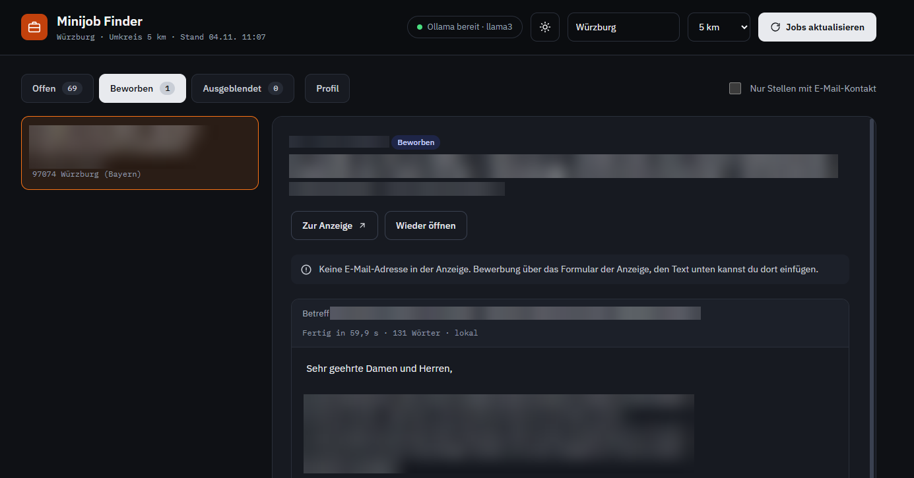
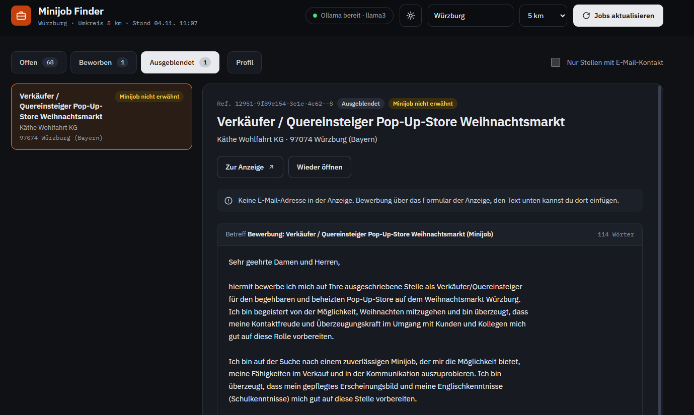

# Minijob Finder



A small local app that finds Minijobs around a city or ZIP code of your choice
on the German Bundesagentur für Arbeit job board, writes a short German
application email for each job you open, and lets you track what you already
applied to.

Everything runs on your PC and is free: emails come from a local
[Ollama](https://ollama.com) model, and if Ollama is not running a fixed
German template is used instead.

## Project layout

```
minijob/
├── app.py              # Flask server: dashboard + JSON API
├── minijob.py          # Refresh workflow and command line entry point
├── jobboard.py         # Bundesagentur für Arbeit API: search, details, filtering
├── emails.py           # Application emails via Ollama, template fallback
├── store.py            # jobs.json and profile.json: load, save, job status
├── HOW_IT_WORKS.md     # How the parts work together, for learning
├── LICENSE             # MIT
├── start.bat           # Windows: set up on first start, then run the app
├── docs/               # Screenshots for this README
├── requirements.txt
├── requirements-dev.txt # pytest, for the tests
├── tests/              # pytest suite, no network or Ollama needed
├── .env.example        # optional: OLLAMA_MODEL / OLLAMA_HOST
├── static/index.html   # Dashboard (no build step)
├── jobs.json           # Created at runtime: jobs, emails and your status
└── profile.json        # Created when you save your profile
```

## Setup

```powershell
python -m venv .venv
.\.venv\Scripts\Activate.ps1
pip install -r requirements.txt
```

For individual emails install Ollama and a model (once):

```powershell
ollama pull qwen2.5:7b
```

Then put `OLLAMA_MODEL=qwen2.5:7b` into a `.env` file (copy `.env.example`).
Without Ollama everything still works, you just get the template email.

## Run

The easiest way on Windows is to double-click `start.bat`. It needs Python, and
on the first start it does the Python setup above for you. It also starts Ollama
if it is installed and opens the browser. Closing its window stops the app.

Or start it by hand after the setup above:

```powershell
python app.py
```

Open <http://127.0.0.1:5000>.

## Using the dashboard

- Enter a city or ZIP code and pick a radius (5 to 100 km) in the header. The
  default is Würzburg, 25 km, and your last search is remembered in `jobs.json`.
  A new search removes jobs that are no longer in the results, including their
  emails and hidden status. Only applied jobs always stay.
- **Jobs aktualisieren** fetches the current listings. It only takes a few
  seconds because known jobs are not fetched or rewritten again.
- Click a job in the list to see its details on the right.
- **E-Mail generieren** writes the email for that one job and stores it. The
  text appears live, word by word, while the model writes; afterwards the box
  shows how long it took. **Neu schreiben** makes a new one.
- **In Gmail öffnen** appears when the listing has a contact address and opens
  a prefilled Gmail draft (recipient, subject and text).
- **Als beworben markieren** moves the job to the "Beworben" tab, **Ausblenden** hides it.
  Both survive refreshes; applied jobs stay even after the listing is gone.
- **Nur Stellen mit E-Mail-Kontakt** hides listings that need an online form.
- **Profil** holds the information the emails are written from: name, place of
  residence, current occupation, skills, availability and a free text. The model
  only uses what is in the profile. Emails written before a change stay as they
  are until you click **Neu schreiben**.
- The sun/moon button in the header switches between dark and light design.
  The choice is remembered in the browser.

Run without the browser: `python minijob.py` (refresh only) or
`python minijob.py --emails` (refresh and write all missing emails).

## Screenshots






## Tests

```powershell
.\.venv\Scripts\python.exe -m pip install -r requirements-dev.txt
.\.venv\Scripts\python.exe -m pytest
```

The tests fake the job board and Ollama, so they run offline in about a
second and never touch your `jobs.json` or `profile.json`.

## Live email streaming

`POST /api/jobs/<refnr>/email/stream` writes the email like
`POST /api/jobs/<refnr>/email`, but answers with NDJSON (one JSON object per
line) while the model writes:

```
{"type": "start", "model": "llama3"}
{"type": "token", "text": "Sehr "}          repeated
{"type": "done", "job": {...}}              the final, cleaned, stored job
```

If Ollama is not running or fails halfway through, `done` carries the template
email, with the reason in `job.email_note`. The dashboard uses this endpoint
and falls back to the classic one if the server has no stream endpoint.

## Notes

- The writing rules for the model are in `_PROMPT`, the fallback text in
  `build_template_email()`, both in `emails.py`. The profile defaults are
  `DEFAULT_PROFILE` in `store.py`.
- City and radius are chosen in the dashboard. Their defaults
  (`DEFAULT_LOCATION`, `DEFAULT_RADIUS`) and the other search settings
  (`SEARCH_PARAMS`, `MAX_PAGES`) are in `jobboard.py`.
- Listings are skipped by title: `QUALIFICATION_KEYWORDS` in `jobboard.py`
  (Erzieher, Therapeut, Krankenpfleger …) always, `ENROLLMENT_KEYWORDS`
  (Student, Werkstudent …) unless the title also says Minijob or Aushilfe.
  Edit the lists to taste.
- The job board's Minijob filter relies on a flag set by the employer, which
  is sometimes also set on regular jobs. Cards whose text never calls the job
  a Minijob are tagged **Minijob nicht erwähnt**.
- Always read the email before sending. Small local models can be clumsy in German.
- `jobs.json`, `profile.json` and `.env` are git-ignored.
